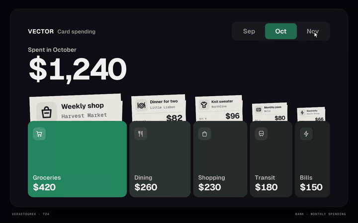

# Monthly Spend

**Every category is a pocket. Tap one and its receipts come out.**



**Live demo:** [veraetogrex-portfolio.github.io/monthly-spend](https://veraetogrex-portfolio.github.io/monthly-spend/) · **Mockup:** [full-screen version](https://veraetogrex-portfolio.github.io/monthly-spend/mockup/monthly-spend.html)

A card-spending screen where each category is a pocket as wide as its share of the month, with its receipts tucked inside. Switch the month and the pockets resize, the biggest one lifts and moves to the front. Tap a pocket: it sinks into a row and its three biggest purchases come out as paper receipts; the rest stay inside as "+2 more".

## Use it

Three files, no build step, no dependencies, no web fonts:

```
index.html   markup
style.css    styles
script.js    data, layout and animation
```

Download the repo and open `index.html`, or copy the three files into your project.

## Try it

- Click Sep, Oct or Nov (or focus the month switch and use ← →). Totals count to the new month while the pockets resize.
- Click any pocket to take its receipts out. Click it again, press Esc or use "All categories" to put them back.
- Open a pocket and switch the month: the receipts slide back in while the pockets resize.

## Make it yours

At the top of `script.js`:

- `CATS` and `SPEND`: categories and dollars per month. Pocket widths follow the shares.
- `BUYS`: the three biggest purchases per category and month (`[what, where, day, $]`) and how many smaller ones there were.
- `ICONS` and `ART`: the line icons on the pockets and receipts.

Colours live in `:root` in `style.css`: `--money` for the biggest pocket, `--paper` and `--ink` for the receipts.

## What's in `mockup/`

The full 1440×900 screen this component was shot in for the reel:

- `mockup/monthly-spend.html` — interactive. `D` plays the demo, `R` resets.
- `mockup/monthly-spend.autoplay.html` — the scripted loop the reel was recorded from.
- URL flags: `?frame` puts the screen in a browser window, `?clean` hides the control panel, `?once` plays the demo once.

The mockup loads the same `style.css` and `script.js` from the root, plus a shared stage runtime and bundled fonts from `mockup/_shared/`. The component in the root doesn't need any of it.

---

Component 24 of a series. New one every day on Instagram [@veraetogrex_portfolio](https://www.instagram.com/veraetogrex_portfolio/) · all components: [github.com/veraetogrex-portfolio](https://github.com/veraetogrex-portfolio)

MIT licensed.
